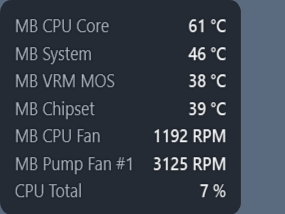
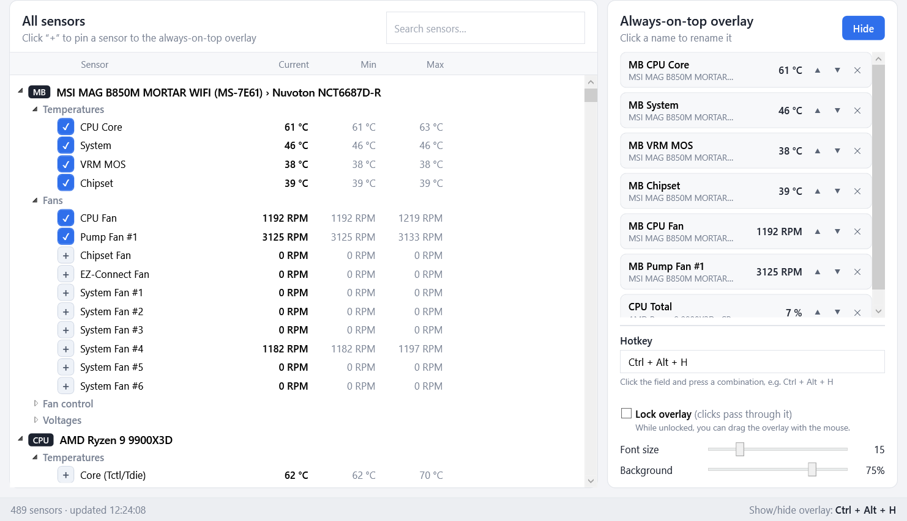

# SensorDeck

A Windows hardware monitor with a compact **always-on-top overlay** that you show and hide with a global hotkey.

Pick the sensors you care about from a full HWiNFO-style sensor list with the **“+”** button, and they appear on the overlay. Press `Ctrl + Alt + H` and the overlay pops up over your browser, IDE or borderless game. Press it again and it's gone.

<p align="center">
  
</p>



## Features

- **Every sensor in your PC**, grouped by device: CPU, GPU (NVIDIA, AMD, Intel), motherboard, memory, drives, network. Each one shows current, min and max values, and the list is searchable.
- **One-click pinning:** the “+” button puts any sensor on the overlay. Overlay rows can be renamed and reordered.
- **Always-on-top overlay** that never steals focus and stays out of Alt+Tab. Drag it anywhere, or lock it so clicks pass straight through. Font size and background opacity are adjustable.
- **Temperature highlighting:** orange from 70 °C, red from 85 °C.
- **Global hotkey** that works from any app. The shortcut is configurable.
- **Tray icon:** closing the window minimizes SensorDeck to the tray instead of quitting.
- **Bundled PawnIO driver installer:** CPU temperatures and motherboard fans need it. Install it with one click, and the new sensors show up without restarting.
- Settings are stored in `%AppData%\SensorDeck\settings.json`.

## Install

1. Download from [Releases](../../releases/latest):
   - `SensorDeck.exe` (~8 MB) requires the [.NET 10 Desktop Runtime](https://dotnet.microsoft.com/download/dotnet/10.0).
   - `SensorDeck-standalone.exe` (~77 MB) has everything included, nothing to install.
2. Run it. Windows will ask for administrator rights, because temperature sensors can't be read without them.
3. If a yellow banner says *PawnIO driver is not installed*, click **Install PawnIO**.
4. Click “+” next to the sensors you want, then use `Ctrl + Alt + H`.

> **Limitation:** like any regular window, the overlay is not visible over games running in exclusive fullscreen. Borderless windowed mode works fine.

## Why administrator rights and a driver?

CPU temperatures, fan speeds and motherboard voltages live in CPU registers and the Super I/O chip, which a normal user-mode app can't access. A kernel driver is required. SensorDeck uses [PawnIO](https://github.com/namazso/PawnIO), an open-source, signed driver that LibreHardwareMonitor switched to as a replacement for the outdated WinRing0 (which Windows Defender flags as vulnerable). GPUs, memory and CPU load are read without it.

## Build from source

Requires the [.NET 10 SDK](https://dotnet.microsoft.com/download/dotnet/10.0).

```bash
git clone https://github.com/pugachoveo/SensorDeck.git
cd SensorDeck/SensorDeck
dotnet build -c Release
```

Single-file exe:

```bash
dotnet publish -c Release -r win-x64 --self-contained false -p:PublishSingleFile=true -p:IncludeNativeLibrariesForSelfExtract=true -o ../publish
```

Headless diagnostics, which write every detected sensor with its current value to a file:

```bash
SensorDeck.exe --dump sensors.txt
```

## Project structure

| File | Purpose |
|---|---|
| `Services/HardwareService.cs` | LibreHardwareMonitorLib wrapper: hardware discovery and value updates |
| `Services/PawnIoInstaller.cs` | PawnIO driver version check and bundled installer |
| `Services/Native.cs` | Global hotkey (`RegisterHotKey`) and topmost window styles |
| `ViewModels/MainViewModel.cs` | Sensor tree, overlay rows, settings |
| `MainWindow.xaml` | Main window with the sensor list |
| `OverlayWindow.xaml` | The always-on-top overlay |

## Credits and licenses

- [LibreHardwareMonitor](https://github.com/LibreHardwareMonitor/LibreHardwareMonitor) for sensor access (MPL-2.0)
- [PawnIO](https://github.com/namazso/PawnIO), the hardware access driver (GPL-2.0). Its installer is bundled unmodified.

SensorDeck is released under the [MIT License](LICENSE). See [THIRD-PARTY-NOTICES.md](THIRD-PARTY-NOTICES.md) for bundled components.
